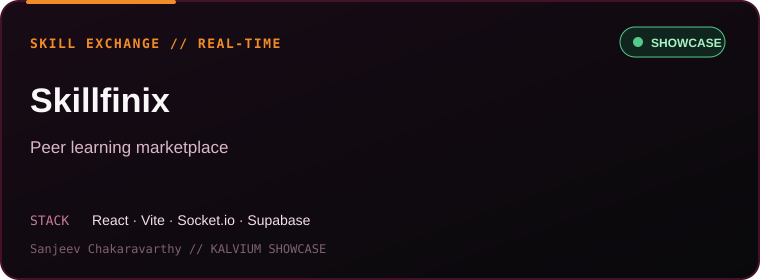
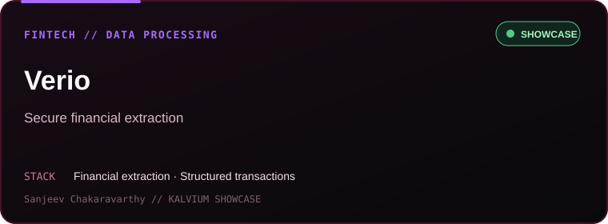
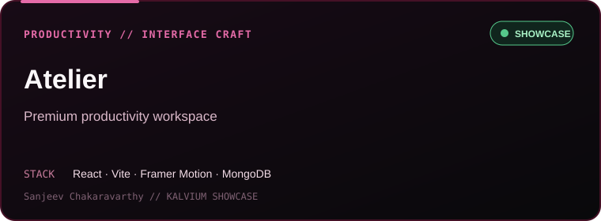
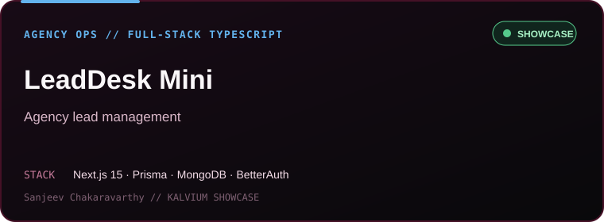
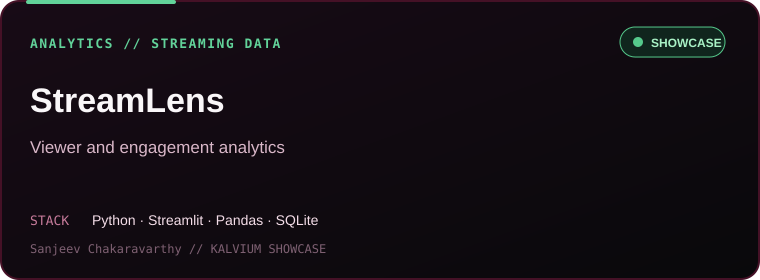

  

## 3D & Spatial Design + Full-Stack Engineering

I design and build interactive web products and **3D / spatial interfaces**, combining clean frontend motion, shader/3D workflows, and reliable full-stack architectures across React, Next.js, TypeScript, Node.js, Python, and SQL/NoSQL databases.

## Technology

**Languages**

**Frontend**

**Backend & Data**

**Platform & Tools**

## Kalvium Student Showcase

<table>
  <tr>
    <td width="50%" valign="top">
      
      <h3>Skillfinix — Skill Exchange Platform</h3>
      
Peer-to-peer skill exchange platform built for sharing knowledge and collaborating on skills.

      
<a href="https://skillfinix.vercel.app/welcome">Live app</a> · <a href="https://github.com/Sanjeev-Chakaravarthy/Skillfinix">GitHub</a>

    </td>
    <td width="50%" valign="top">
      
      <h3>Verio — Secure Financial Extraction</h3>
      
Focused on financial statement extraction and structured transaction processing.

      
<a href="https://verio-secure-financial-extraction-v-kappa.vercel.app">Live app</a> · <i>GitHub not provided</i>

    </td>
  </tr>
  <tr>
    <td width="50%" valign="top">
      
      <h3>Atelier — Premium Productivity Workspace</h3>
      
Productivity workspace built with a focus on interface craft and smooth motion.

      
<a href="https://github.com/Sanjeev-Chakaravarthy/Atelier">GitHub</a> · <i>Live app not provided</i>

    </td>
    <td width="50%" valign="top">
      
      <h3>LeadDesk Mini — Agency Lead Management</h3>
      
Agency lead management application built with a modern full-stack TypeScript setup.

      
<a href="https://lead-desk-mini-gray.vercel.app/">Live app</a> · <a href="https://github.com/Sanjeev-Chakaravarthy/LeadDesk-Mini">GitHub</a>

    </td>
  </tr>
  <tr>
    <td width="50%" valign="top">
      
      <h3>StreamLens — Streaming Analytics Dashboard</h3>
      
Streaming analytics dashboard for exploring viewer and engagement metrics.

      
<a href="https://streamlens-team.streamlit.app/">Live app</a> · <a href="https://github.com/Sanjeev-Chakaravarthy/team03-65">GitHub</a>

      
<small>Viewer-behaviour data is synthetic, not real-world user data.</small>

    </td>
    <td width="50%" valign="top">
      <h3>More experiments coming soon</h3>
      
Exploring product engineering, interactive 3D interfaces, and data-rich experiences.

      
<a href="https://github.com/Sanjeev-Chakaravarthy">View GitHub profile</a>

    </td>
  </tr>
</table>

## Education

**B.Tech in Computer Science & Engineering** — *Software Product Engineering*  
**Lovely Professional University × Kalvium** · 2024–2028 · Jalandhar, Punjab  
**CGPA: 9.13 / 10.0**

## Recognition

- 🥈 **Runner-up — Code-A-Hunt 2.0**, Lovely Professional University
- 🎓 **Kalvium Industry Program Scholar**, Software Product Engineering fellowship
- 🚀 **Founder & Engineering Lead — WIBUILT**, digital products and WebGL experiences

## GitHub

  

## Let's Build

Open to **engineering internships**, meaningful collaborations, and ambitious product challenges.

  

