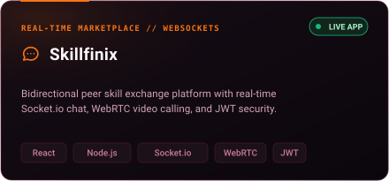

<div align="center">
  
</div>

<div align="center">

[](https://wibuilt.com)
[](https://www.linkedin.com/in/sanjeev-m-s-908188325/)
[](mailto:sanjeev.ms28122@gmail.com)

</div>

## About

**Software Product Engineering student** at **Lovely Professional University × Kalvium**, building thoughtful digital products across the full stack.

I work across **React / Next.js**, **TypeScript**, **Node.js**, **Python**, and **PostgreSQL / MongoDB**—with a strong interest in scalable APIs, secure systems, real-time experiences, and interactive 3D interfaces.

```text
PRODUCT THINKING  +  CLEAN ARCHITECTURE  +  SHIPPED EXPERIENCES
```

<details>
<summary><b>What I engineer</b></summary>

- End-to-end web applications with type-safe, modular architectures
- Responsive interfaces focused on performance and accessibility
- REST APIs, authentication systems, and real-time communication
- Relational and document data models with careful indexing
- Interactive WebGL experiences with adaptive rendering
- Open-source tools and distributed systems experiments

</details>

## Technology

<div align="center">

**Languages**


**Frontend**


**Backend & Data**


**Platform & Tools**


</div>

## Featured Work

<table>
  <tr>
    <td width="50%" valign="top">
      <a href="https://github.com/Sanjeev-Chakaravarthy/Skillfinix">
        
      </a>
      <h3>Skillfinix</h3>
      <p><i>Collaborative peer-to-peer skill exchange</i></p>
      <p>Algorithmic skill matching, real-time chat, and WebRTC sessions in a focused learning marketplace.</p>
      <p><b>React · Node.js · MongoDB · Socket.IO · WebRTC</b></p>
      <p><a href="https://github.com/Sanjeev-Chakaravarthy/Skillfinix">Repository</a> · <a href="https://skillfinix.vercel.app">Live demo</a></p>
    </td>
    <td width="50%" valign="top">
      <a href="https://github.com/Sanjeev-Chakaravarthy/PG-Finder">
        
      </a>
      <h3>PG Finder</h3>
      <p><i>Student accommodation discovery</i></p>
      <p>A broker-free accommodation platform for finding verified PGs by location, price, and amenities.</p>
      <p><b>React · Express · MongoDB · REST APIs · Tailwind</b></p>
      <p><a href="https://github.com/Sanjeev-Chakaravarthy/PG-Finder">Repository</a> · <a href="https://pg-finder-pink.vercel.app">Live demo</a></p>
    </td>
  </tr>
  <tr>
    <td width="50%" valign="top">
      <a href="https://github.com/Sanjeev-Chakaravarthy/Verio-Secure-Financial-Extraction-Verification">
        
      </a>
      <h3>Verio</h3>
      <p><i>Secure financial transaction extraction</i></p>
      <p>Workspace-isolated transaction parsing with confidence scoring and database-enforced tenant isolation.</p>
      <p><b>Next.js · TypeScript · Hono · PostgreSQL · Prisma</b></p>
      <p><a href="https://github.com/Sanjeev-Chakaravarthy/Verio-Secure-Financial-Extraction-Verification">Repository</a> · <a href="https://verio-secure-financial-extraction-v.vercel.app">Live demo</a></p>
    </td>
    <td width="50%" valign="top">
      <a href="https://wibuilt.com">
        
      </a>
      <h3>WIBUILT</h3>
      <p><i>Creative WebGL & 3D studio</i></p>
      <p>Adaptive Three.js experiences with GPU-aware rendering pipelines and fluid 60fps interactions.</p>
      <p><b>Next.js · Three.js · React · TypeScript · Framer Motion</b></p>
      <p><a href="https://wibuilt.com">Live studio</a> · <i>Private client repository</i></p>
    </td>
  </tr>
</table>

## Education

**B.Tech in Computer Science & Engineering** — *Software Product Engineering*  
**Lovely Professional University × Kalvium** · 2024–2028 · Jalandhar, Punjab  
**CGPA: 9.13 / 10.0**

## Recognition

- 🥈 **Runner-up — Code-A-Hunt 2.0**, Lovely Professional University
- 🎓 **Kalvium Industry Program Scholar**, Software Product Engineering fellowship
- 🚀 **Founder & Engineering Lead — WIBUILT**, digital products and WebGL experiences

## GitHub

<div align="center">
  <a href="https://github.com/Sanjeev-Chakaravarthy">
    
  </a>
</div>

<div align="center">

[](https://github.com/Sanjeev-Chakaravarthy?tab=repositories)
[](https://github.com/Sanjeev-Chakaravarthy)

</div>

## Let's Build

Open to **engineering internships**, meaningful collaborations, and ambitious product challenges.

[](https://www.linkedin.com/in/sanjeev-m-s-908188325/)
[](https://wibuilt.com)
[](mailto:sanjeev.ms28122@gmail.com)

<div align="center">
  
</div>
