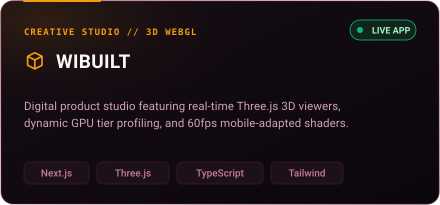
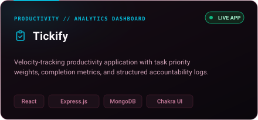
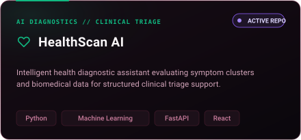

<!-- 01. ANIMATED HERO BANNER -->

 

<!-- 02. INTRODUCTION / ABOUT ME -->
## ✦ About Me

I am a **Software Product Engineering & Computer Science scholar** at **Lovely Professional University × Kalvium** (Batch of 2024–2028), focused on building high-performance web applications, interactive 3D digital experiences, and scalable backend architecture.

My approach to engineering combines clean, responsive frontend systems with resilient API backends and data layer design:
* **Full-Stack Application Development**: Designing end-to-end applications with modular architecture, strict type safety, and production observability.
* **Frontend Engineering**: Crafting intuitive interfaces using React, Next.js 15, and Tailwind CSS with a relentless focus on performance, accessibility, and user feedback.
* **Backend Systems & APIs**: Building robust REST endpoints and micro-handlers with Node.js, Express, Hono, and secure session management.
* **Database & Data Architecture**: Designing normalized schemas, optimized query indexes, and multi-tenant isolation across MongoDB and PostgreSQL.
* **Creative & Spatial Computing**: Implementing interactive WebGL/Three.js 3D viewers with dynamic GPU tier profiling and fluid 60fps animations.
* **AI-Powered Product Engineering**: Experimenting with diagnostic AI models, intelligent transaction parsers, and machine learning triage pipelines.
* **Open-Source & Systems Exploration**: Actively contributing, studying distributed systems, Redis caching topologies, and Go for systems programming.

> *"Engineering digital products through disciplined architecture, intentional experimentation, and thoughtful design."*

 

<!-- 03. TECHNICAL SKILLS -->
## 🛠 Technical Expertise

<table>
  <tr>
    <td width="50%" valign="top">
      <h4>💻 Languages &amp; Core</h4>
      <ul>
        <li><b>JavaScript (ES6+)</b> • Asynchronous patterns, DOM, event loops, modern standards</li>
        <li><b>TypeScript</b> • Strict typing, generics, interfaces, modular architectures</li>
        <li><b>Python</b> • Scripting, data analysis, ML experimentation, FastAPI</li>
        <li><b>Java &amp; C++</b> • Object-oriented programming, data structures, algorithms</li>
        <li><b>SQL</b> • Relational querying, joins, constraints, migrations</li>
        <li><b>Go</b> • <i>(Actively exploring)</i> Systems programming &amp; microservices</li>
      </ul>
    </td>
    <td width="50%" valign="top">
      <h4>🌐 Frontend Architecture</h4>
      <ul>
        <li><b>React.js &amp; Next.js 15</b> • Server Components, hooks, routing, SSR/SSG</li>
        <li><b>Tailwind CSS &amp; Chakra UI</b> • Mobile-first responsive design, modern design tokens</li>
        <li><b>HTML5 &amp; CSS3</b> • Semantic markup, CSS grid/flexbox, animations</li>
        <li><b>Framer Motion</b> • Layout animations, physics-based transitions</li>
        <li><b>State Management</b> • Redux Toolkit, Context API, Zustand</li>
      </ul>
    </td>
  </tr>
  <tr>
    <td width="50%" valign="top">
      <h4>⚙️ Backend &amp; Distributed Systems</h4>
      <ul>
        <li><b>Node.js &amp; Express.js</b> • Scalable RESTful API architecture, middleware</li>
        <li><b>Hono</b> • Ultra-fast edge micro-handlers &amp; serverless functions</li>
        <li><b>WebSockets (Socket.IO)</b> • Real-time duplex channels, presence, room states</li>
        <li><b>WebRTC</b> • P2P live video and media streaming handshakes</li>
        <li><b>Security &amp; Auth</b> • JWT authentication, Better Auth, Google OAuth, CORS, IDOR prevention</li>
      </ul>
    </td>
    <td width="50%" valign="top">
      <h4>🗄️ Database, Cloud &amp; Tools</h4>
      <ul>
        <li><b>MongoDB &amp; Mongoose</b> • Document modeling, aggregation pipelines, indexing</li>
        <li><b>PostgreSQL (Neon) &amp; Prisma</b> • Relational schemas, migrations, tenant isolation</li>
        <li><b>Three.js &amp; WebGL</b> • 3D scene graphs, lighting shaders, GPU tier detection</li>
        <li><b>Developer Tooling</b> • Git, GitHub, VS Code, Postman, Bruno, Figma</li>
        <li><b>Deployment &amp; Hosting</b> • Vercel, Render, Cloudinary, Netlify</li>
      </ul>
    </td>
  </tr>
</table>

 

<!-- 04. FEATURED PROJECTS -->
## 🚀 Featured Projects

A curated selection of real-world products, architecture experiments, and production platforms built with verified codebases and live deployments.

 

<table>
  <tr>
    <td width="50%" valign="top">
      
       
      <b>Skillfinix</b> • <i>Collaborative Peer-to-Peer Skill Exchange Platform</i>
        
      Bidirectional learning marketplace connecting students and mentors. Features algorithmic skill matching, real-time Socket.io chat rooms with typing indicators, and WebRTC live video sessions.
        
      <b>Stack:</b> React, Node.js, Express.js, MongoDB, Socket.io, WebRTC, JWT, Tailwind CSS  
       
      🔗 <b>Links:</b> <a href="https://github.com/Sanjeev-Chakaravarthy/Skillfinix">GitHub Repository</a> • <a href="https://skillfinix.vercel.app">Live Application</a>
    </td>
    <td width="50%" valign="top">
      
       
      <b>PG Finder</b> • <i>Student Accommodation &amp; Paying Guest Discovery Hub</i>
        
      Full-stack property platform enabling university students to locate and inspect verified accommodations by proximity, pricing, and amenities with zero broker fees.
        
      <b>Stack:</b> React, Node.js, Express.js, MongoDB, REST APIs, Tailwind CSS, Vercel  
       
      🔗 <b>Links:</b> <a href="https://github.com/Sanjeev-Chakaravarthy/PG-Finder">GitHub Repository</a> • <a href="https://pg-finder-pink.vercel.app">Live Application</a>
    </td>
  </tr>
  <tr>
    <td width="50%" valign="top">
      
       
      <b>Verio</b> • <i>Workspace-Isolated Financial Transaction Extractor</i>
        
      High-assurance transaction parser converting raw bank SMS messages and statements into structured double-entry ledgers with confidence scoring and database-enforced multi-tenant isolation.
        
      <b>Stack:</b> Next.js 15, TypeScript, Hono, Neon PostgreSQL, Prisma ORM, Better Auth  
       
      🔗 <b>Links:</b> <a href="https://github.com/Sanjeev-Chakaravarthy/Verio-Secure-Financial-Extraction-Verification">GitHub Repository</a> • <a href="https://verio-secure-financial-extraction-v.vercel.app">Live Application</a>
    </td>
    <td width="50%" valign="top">
      
       
      <b>WIBUILT</b> • <i>Creative Web Studio &amp; Interactive 3D WebGL Platform</i>
        
      Commercial product studio featuring interactive Three.js 3D asset visualizers, dynamic client GPU tier profiling (high/medium/low adaptive LOD), and fluid 60fps rendering pipelines.
        
      <b>Stack:</b> Next.js, Three.js, React, TypeScript, Tailwind CSS, Framer Motion  
       
      🔗 <b>Links:</b> <a href="https://wibuilt.com">Studio Website (Live)</a> • <i>Client Repository (Private)</i>
    </td>
  </tr>
  <tr>
    <td width="50%" valign="top">
      
       
      <b>Tickify</b> • <i>Task Management Dashboard &amp; Productivity Velocity Analytics</i>
        
      Interactive task workspace calculating completion velocity, priority weighting matrices, and visual accountability logs for disciplined daily execution.
        
      <b>Stack:</b> React, Node.js, Express.js, MongoDB, Tailwind CSS, Chakra UI  
       
      🔗 <b>Links:</b> <a href="https://github.com/kalviumcommunity/S65_Tickify">GitHub Repository</a> • <a href="https://s65-tickify.vercel.app">Live Application</a>
    </td>
    <td width="50%" valign="top">
      
       
      <b>HealthScan AI</b> • <i>Intelligent Health Diagnosis &amp; Preliminary Triage Assistant</i>
        
      AI-driven diagnostic prototype analyzing symptom clusters and health biomarkers to provide structured preliminary clinical triage evaluations.
        
      <b>Stack:</b> Python, Machine Learning Models, FastAPI, React, RESTful Services  
       
      🔗 <b>Links:</b> <a href="https://github.com/Sanjeev-Chakaravarthy/HealthScan-AI">GitHub Repository</a> • <i>Research &amp; Active Development</i>
    </td>
  </tr>
</table>

 

<!-- 05. EDUCATION -->
## 🎓 Education

<table>
  <tr>
    <td width="100%">
      <h3>B.Tech in Computer Science and Engineering</h3>
      <b>Specialization in Software Product Engineering</b> 
      <b>Lovely Professional University (LPU)</b> in collaboration with <b>Kalvium</b> 
      <i>Period: 2024 – 2028 • Jalandhar, Punjab, India</i> 
      <b>Academic Standing:</b> CGPA <b>9.13 / 10.0</b> (Verified Official Record)
        
      <ul>
        <li><b>Core Curriculum:</b> Data Structures &amp; Algorithms, Object-Oriented Software Design, Operating Systems, Database Management Systems, Computer Networks.</li>
        <li><b>Industry Immersion:</b> Work-integrated Software Product Engineering program emphasizing full-stack development, code craftsmanship, continuous delivery, and product architecture.</li>
      </ul>
    </td>
  </tr>
</table>

 

<!-- 06. ACHIEVEMENTS & CERTIFICATIONS -->
## 🏆 Verified Achievements &amp; Recognition

* 🥈 **Runner-up — Code-A-Hunt 2.0 (Lovely Professional University)**  
  Ranked among top performers in an intensive university-wide competitive programming and algorithmic problem-solving challenge.
* 🎓 **Kalvium Industry Program Scholar**  
  Selected for the rigorous Kalvium Software Product Engineering fellowship, focusing on real-world engineering standards and agile development.
* 🚀 **Founder &amp; Engineering Lead — WiBuilt**  
  Spearheaded design and full-stack development for digital platforms, interactive 3D WebGL experiences, and institutional workflow automation.

 

<!-- 07. GITHUB CONTRIBUTION GRAPH -->
## 📈 Contribution Activity &amp; Heatmap

  

  <i>Telemetry verified directly from GitHub GraphQL API: 409 verified contributions across 53 weeks.</i>

 

<!-- 08. GITHUB STATISTICS -->
## 📊 Engineering Statistics &amp; Metrics

  
  &nbsp;
  

  

 

<!-- 09. CONNECT WITH ME -->
## 🌍 Connect &amp; Collaborate

Open for engineering internships, collaborative open-source ventures, and innovative software development challenges. Let's connect!

 

  
  &nbsp;
  
  &nbsp;
  
  &nbsp;
  

 

<!-- 10. CUSTOM ANIMATED FOOTER -->

  

