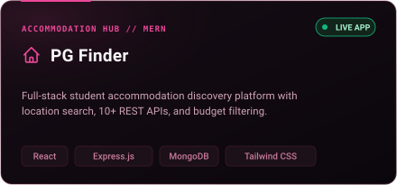
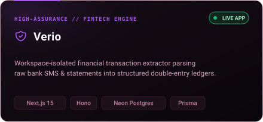

  

**[Portfolio](https://wibuilt.com)** &nbsp;·&nbsp; **[LinkedIn](https://www.linkedin.com/in/sanjeev-m-s-908188325/)** &nbsp;·&nbsp; **[Email](mailto:sanjeev.ms28122@gmail.com)**

 

## About

I am a **Software Product Engineering** student at **Lovely Professional University × Kalvium**, focused on building reliable full-stack products, intuitive interfaces, and scalable backend systems.

I work across JavaScript and TypeScript, React and Next.js, Node.js and Python, PostgreSQL and MongoDB. My interests sit where **product thinking**, **clean architecture**, and **interactive technology** meet.

 

## Technology

| Frontend | Backend & APIs | Data & 3D |
|---|---|---|
| JavaScript · TypeScript | Node.js · Express.js | MongoDB · Mongoose |
| React · Next.js | Hono · REST APIs | PostgreSQL · Prisma |
| Tailwind CSS | Better Auth · JWT | Socket.IO · WebRTC |
| Framer Motion | Authentication · Security | Three.js · WebGL |

 

## Selected Work

<table>
  <tr>
    <td width="50%" valign="top">
      
      <h3>Skillfinix</h3>
      
<b>Peer-to-peer learning, made practical.</b>

      
Skill matching, real-time chat, and WebRTC sessions in a collaborative learning marketplace.

      
<code>React</code> <code>Node.js</code> <code>MongoDB</code> <code>Socket.IO</code> <code>WebRTC</code>

      
<a href="https://github.com/Sanjeev-Chakaravarthy/Skillfinix">Repository</a> · <a href="https://skillfinix.vercel.app">Live demo</a>

    </td>
    <td width="50%" valign="top">
      
      <h3>PG Finder</h3>
      
<b>Discover verified student accommodation.</b>

      
A broker-free platform for comparing student PGs by location, price, and amenities.

      
<code>React</code> <code>Express</code> <code>MongoDB</code> <code>REST APIs</code> <code>Tailwind CSS</code>

      
<a href="https://github.com/Sanjeev-Chakaravarthy/PG-Finder">Repository</a> · <a href="https://pg-finder-pink.vercel.app">Live demo</a>

    </td>
  </tr>
  <tr>
    <td width="50%" valign="top">
      
      <h3>Verio</h3>
      
<b>Secure financial transaction extraction.</b>

      
Workspace-isolated parsing with confidence scoring and database-enforced tenant isolation.

      
<code>Next.js</code> <code>TypeScript</code> <code>Hono</code> <code>PostgreSQL</code> <code>Prisma</code>

      
<a href="https://github.com/Sanjeev-Chakaravarthy/Verio-Secure-Financial-Extraction-Verification">Repository</a> · <a href="https://verio-secure-financial-extraction-v.vercel.app">Live demo</a>

    </td>
    <td width="50%" valign="top">
      
      <h3>WIBUILT</h3>
      
<b>Creative WebGL and 3D experiences.</b>

      
Adaptive Three.js experiences with GPU-aware rendering and fluid interactive motion.

      
<code>Next.js</code> <code>Three.js</code> <code>React</code> <code>TypeScript</code> <code>Framer Motion</code>

      
<a href="https://wibuilt.com">Live studio</a> · <i>Private client repository</i>

    </td>
  </tr>
</table>

 

## Education & Recognition

**B.Tech in Computer Science & Engineering — Software Product Engineering**  
Lovely Professional University × Kalvium · 2024–2028 · Jalandhar, Punjab  
**CGPA: 9.13 / 10.0**

- 🥈 **Runner-up — Code-A-Hunt 2.0**, Lovely Professional University
- 🎓 **Kalvium Industry Program Scholar**, Software Product Engineering fellowship
- 🚀 **Founder & Engineering Lead — WIBUILT**, digital products and WebGL experiences

 

## GitHub Activity

  

> The graphic above is an activity illustration; it does not represent verified GitHub contribution totals.

 

## Let’s Build

Open to **engineering internships**, meaningful collaborations, and ambitious product challenges.

**[Portfolio](https://wibuilt.com)** &nbsp;·&nbsp; **[GitHub](https://github.com/Sanjeev-Chakaravarthy)** &nbsp;·&nbsp; **[LinkedIn](https://www.linkedin.com/in/sanjeev-m-s-908188325/)** &nbsp;·&nbsp; **[Email](mailto:sanjeev.ms28122@gmail.com)**

  

